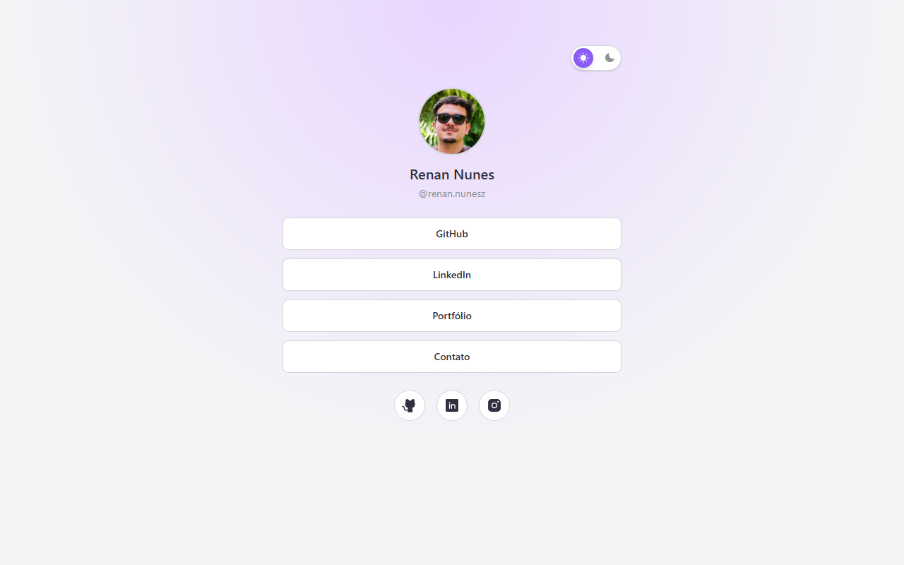
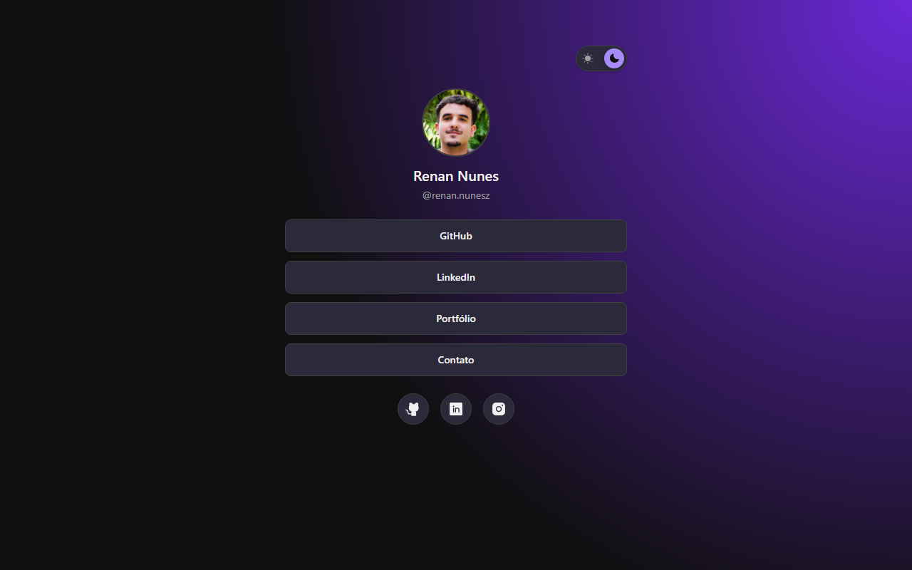
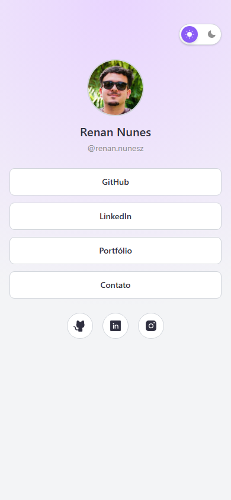
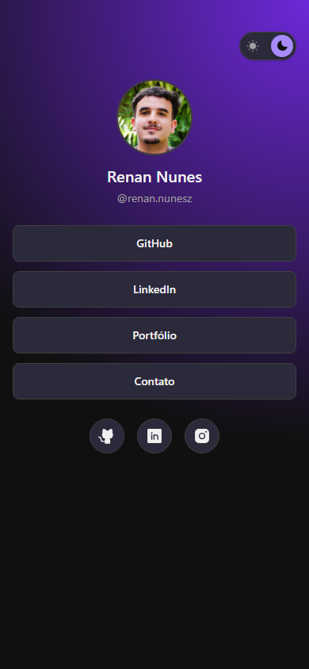

# DevLinks

Página de links pessoal em React + Vite + TypeScript, reproduzindo o design do Figma nos modos claro e escuro, em desktop e mobile.

**Autor:** Renan Nunes · [GitHub](https://github.com/RenanNunesz10)

## Como instalar e executar

```bash
npm install
npm run dev
```

Abra `http://localhost:5173/`. Para gerar a versão de produção: `npm run build`.

## Tecnologias

- React 19 + Vite
- TypeScript
- Tailwind CSS v4 (via `@tailwindcss/vite`) para estilização, com variáveis CSS para os temas claro e escuro
- localStorage para salvar o tema
- Phosphor Icons para os ícones das redes sociais e do botão de tema

## Personalização

- Nome, usuário e fotos do perfil: `src/data/profile.ts`
- Botões de link: `src/data/links.ts`
- Redes sociais: `src/data/socials.ts`

A foto do perfil muda conforme o tema: com óculos no tema claro e sem óculos no escuro (arquivos em `src/assets`).

## Prints

| Desktop — Claro | Desktop — Escuro |
| :---: | :---: |
|  |  |

| Mobile — Claro | Mobile — Escuro |
| :---: | :---: |
|  |  |

## Documentação

- [`AGENTS.md`](AGENTS.md): instruções para o agente de IA
